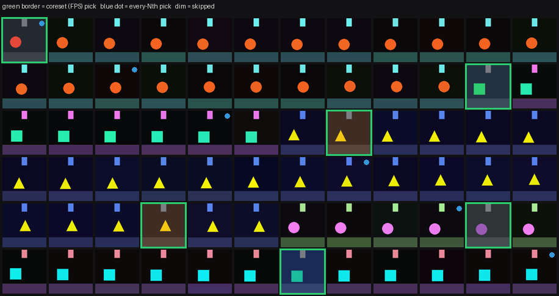

# frame-picker

Embedding-based data curation for a labeling budget, in ~150 lines of Python.
A tiny working version of the core idea behind [Lightly](https://lightly.ai)'s
Selection product: when you can only afford to label K frames, pick the K most
*diverse* ones instead of every Nth one.

## The labeling-budget problem

A camera on a robot arm records at a fixed rate, but the scene barely changes
between consecutive frames. Dump the raw feed into a labeling tool and you pay
to annotate hundreds of near-duplicates while rare-but-important frames get
crowded out. Naive every-Nth-frame sampling helps a little, but it samples
*time*, not *content*: it oversamples long static stretches and can skip short
distinct events entirely.

The fix is to sample in embedding space: embed every frame with a pretrained
vision model, then greedily pick the frame farthest from everything already
selected (farthest-point sampling, a greedy coreset construction). This is the
diversity-based selection strategy Lightly ships in production - see their
[selection docs](https://docs.lightly.ai/docs/selection) and the open-source
[lightly SSL library](https://github.com/lightly-ai/lightly), which also lets
you train the embedding model itself with self-supervised learning (and
[LightlyTrain](https://github.com/lightly-ai/lightly-train) for pretraining on
your own unlabeled data). This repo is an independent mini-demo of that idea,
not affiliated with Lightly.

## What the demo shows

1. `make_dataset.py` renders a synthetic 72-frame "camera feed" with PIL:
   five distinct scenes (different backgrounds, colored objects drifting a few
   pixels per frame, exposure flicker), with deliberately uneven dwell times -
   long runs of near-duplicates, just like real teleop recordings. The repo is
   fully self-contained; no dataset download needed.
2. `frame_picker.py` embeds all frames with torchvision ResNet-18 (ImageNet
   weights, CPU-only, 512-d penultimate layer, L2-normalized), then selects a
   budget of K frames two ways:
   - **every-Nth** (naive, time-uniform)
   - **farthest-point sampling** (greedy coreset, content-diverse)

   It prints both selections with two metrics (mean pairwise embedding
   distance = diversity, and closest-pair distance = redundancy) and saves a
   grid image marking which frames each strategy picked.

## Quickstart

```
pip install -r requirements.txt
python make_dataset.py
python frame_picker.py --k 6
```

CPU-only, no API keys. ResNet-18 weights (~45 MB) auto-download on first run.

## Real output

```
Embedding 72 frames with ResNet-18 (CPU)...

Labeling budget K = 6 of 72 frames

Every-Nth sampling (naive):
  frame_000.png, frame_014.png, frame_028.png, frame_043.png, frame_057.png, frame_071.png
  diversity (mean pairwise dist): 0.5073
  closest pair distance:          0.1655

Coreset selection (greedy farthest-point sampling):
  frame_000.png, frame_022.png, frame_031.png, frame_051.png, frame_058.png, frame_066.png
  diversity (mean pairwise dist): 0.5547
  closest pair distance:          0.2693

Saved selection grid to selection_grid.png
```

With a budget of 6 labels, coreset selection buys +9% mean diversity and a
63% larger closest-pair distance - i.e. every-Nth still spends part of the
budget on frames that look nearly identical, while FPS spreads the budget
across all five scenes.



Green border = coreset pick, blue dot = every-Nth pick, dimmed = skipped.
Note how every-Nth burns picks inside the long static scenes while FPS covers
each distinct scene, including the 6-frame one.

## Why I built this

I (Muhammad Abdulrehman) face exactly this problem at Drexel's McDonald Lab:
I collect robot-arm RealSense camera data and curate it in Roboflow for
YOLO / RF-DETR training, where redundant near-duplicate frames eat the
labeling budget. This is the problem Lightly solves at scale.
